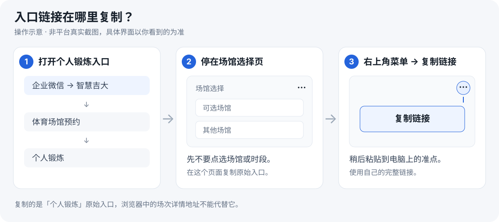
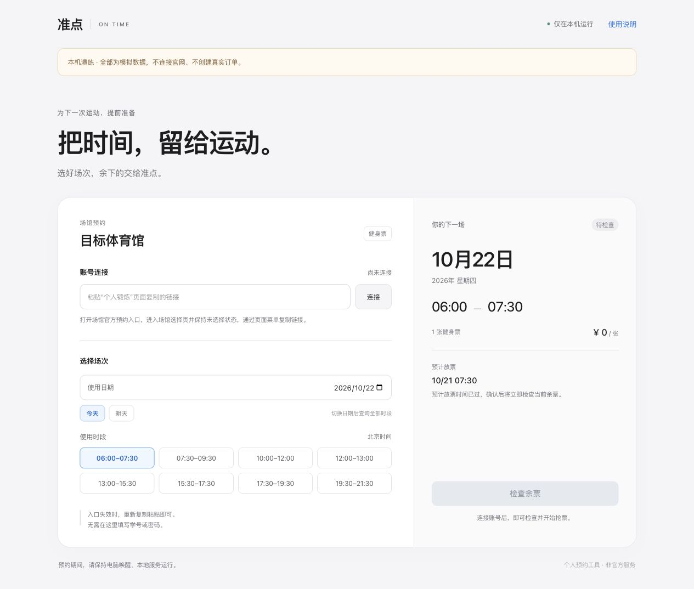
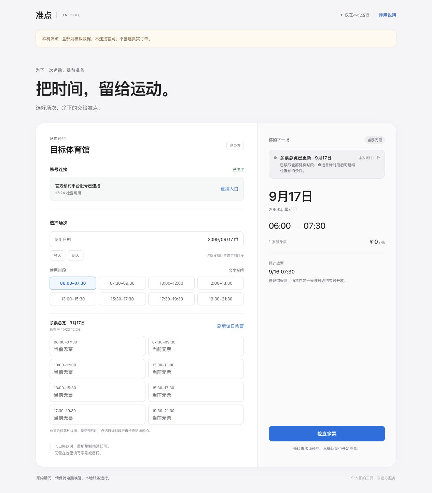
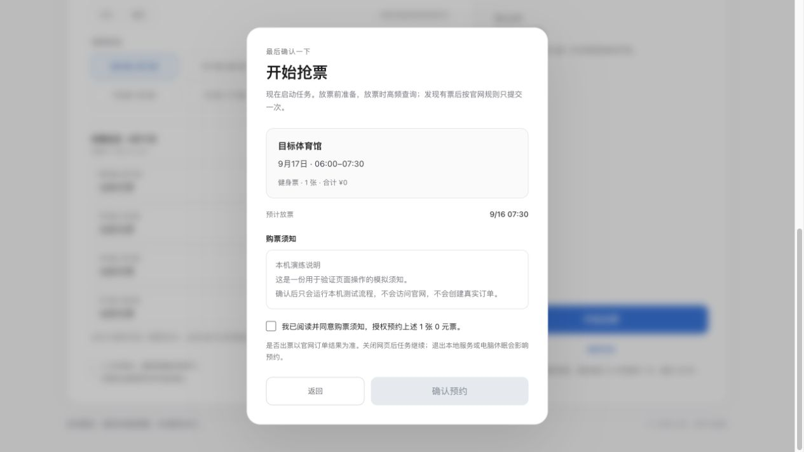

<div align="center">

# 准点 · ON TIME

**把时间，留给运动。**

看余票、选场次、提前准备下一次运动。

[下载使用](https://github.com/jianyuanliljy-hub/ontime-booking/archive/refs/heads/main.zip) · [从这里开始](#开始使用) · [常见问题](#遇到问题先看这里)

</div>

准点把余票查询和预约放在一个页面里。连接本人账号后，可以查看各时段余量，选择使用日期和时段；需要提前等待放票时，阅读须知并确认即可启动任务。

## 开始使用

第一次按下面的顺序操作。之后通常只需双击启动、粘贴本人入口。

### 1. 下载到电脑并解压

点击 **[下载项目 ZIP](https://github.com/jianyuanliljy-hub/ontime-booking/archive/refs/heads/main.zip)**，将整个文件夹解压到自己的电脑上。

**先解压，再运行。** 不要直接在压缩包里双击启动文件。

### 2. 从手机复制本人预约入口

在企业微信里打开 **智慧吉大 → 体育场馆预约 → 个人锻炼**。

到达**场馆选择页**后，先不要选择场馆或时段，点击右上角 **「⋯ → 复制链接」**。把这条完整链接带到自己的电脑上，下一步会用到。



*上图是操作示意，具体菜单以当前页面为准。要复制的是尚未选择场馆时的个人入口，已经进入某场次后的详情地址不能代替它。*

链接包含本人的账号标识。只在自己的电脑上使用，不要贴到公开 Issue、群聊或截图里；也不需要把学号、密码发给别人。

### 3. 第一次填写场馆设置

在解压后的文件夹里找到 `site.example.json`，复制一份，命名为 **`site.local.json`**，用记事本或纯文本编辑器打开。

只需填写三项，信息都来自刚才的入口和预约页面：

| 要填的内容 | 怎么找 |
| --- | --- |
| `origin` | 链接最前面的 `https://` 和域名，后面的路径不要带上 |
| `venue` | 你准备预约的场馆完整名称，照页面原文填写 |
| `club_id` | 链接里 `clubId=` 后的数字，保留外面的英文双引号 |

例如，**下面全部是虚构示例，请换成自己的信息**：

```text
https://tickets.example.org/easyserpApp/index.html#/branch?clubId=26&userId=YOUR_PRIVATE_ID
```

```json
{
  "origin": "https://tickets.example.org",
  "venue": "示例体育馆",
  "club_id": "26"
}
```

保存后，设置通常不需要每次重填。**完整个人链接不写进这个文件，`userId` 和 token 也不用填。** 下一步只把完整链接粘贴到准点页面。

Windows 请确认文件名没有变成 `site.local.json.txt`。macOS 编辑时使用纯文本，保留英文双引号和逗号。配置文件只留在本机，仓库不会收录。

### 4. 启动准点，粘贴链接并连接

电脑需要安装 **Python 3.9 或更新版本**。除此之外，无需安装其他运行包。

| 你的电脑 | 怎么启动 |
| --- | --- |
| **Windows** | 双击 **`start-ontime.cmd`**；提示找不到 Python 时，先安装 [Windows 版 Python](https://www.python.org/downloads/windows/)，确保 `py` 或 `python` 命令可用，再双击一次 |
| **macOS** | 双击 **`启动准点.command`**；若无法打开，用终端在项目目录运行 `python3 "ticket_web.py" --open` |
| **Linux** | 在项目目录运行 `python3 "ticket_web.py" --open` |

启动后，浏览器会打开 **[http://127.0.0.1:8765](http://127.0.0.1:8765)**。如果没有自动打开，手动访问这个地址即可。

将第 2 步复制的完整链接粘贴到「账号连接」输入框，点击 **「连接」**。连接成功后，会自动读取默认日期的全部健身时段余票。



*这是本机离线演示截图，未连接真实账号。你实际看到的日期和余票以当前查询为准。*

Windows 可以原生运行，无需 WSL。启动后出现的窗口要保持打开，预约期间也要保持电脑唤醒和网络连接。

### 5. 选日期、选时段，先检查再预约

1. 选择**实际到馆的使用日期**。想约明天就点「明天」，不要把预计放票日期当作使用日期。
2. 在余票总览里点选目标时段，再点 **「检查余票」**。
3. 需要预约时，点 **「开始抢票」**，阅读完整须知，勾选同意后再确认。
4. 任务启动后查看页面进度。只有明确查到对应订单，页面才会显示确认出票；最后回到官方平台查看凭证。



*离线演示：日期和余票均为模拟。总览卡用于选时段，之后仍需点击「检查余票」。*



*离线演示：检查日期和时段，阅读须知后勾选同意。截图未确认预约，不代表真实出票。*

未到预计放票时间时，可以提前启动等待；预计时间已过时，按钮会显示「立即开始抢票」。当前无票、余量未知、已有订单等情况会在结果卡中分别说明。

**关闭网页后，仍在运行的任务会继续。关闭启动窗口、退出服务或电脑休眠会影响预约。** 等待阶段可点击停止；已进入提交或订单核对阶段时，停止程序不会撤销官网订单。

## 遇到问题，先看这里

<details>
<summary><strong>粘贴链接后提示入口不正确或失效，怎么办？</strong></summary>

回到企业微信里的「个人锻炼」，重新打开尚未选择场馆的页面，再从右上角菜单复制。不要用已选择场馆、已进入某张票详情后的地址。

如果是首次连接，也检查 `site.local.json` 的域名和 `club_id` 是否来自同一条入口。程序重启后需要重新粘贴；入口能用多久由实际登录结果判断。

</details>

<details>
<summary><strong>双击后没有打开页面，或提示找不到 Python？</strong></summary>

先确认项目已完整解压。Windows 启动窗口会显示错误并保留；提示缺少 Python 时，安装 Python 3.9+，确保启动器或命令可用。macOS 可以改用上面的终端命令。

服务已经启动但浏览器没打开时，访问 http://127.0.0.1:8765。端口占用时，可以在项目目录运行以下命令换端口：

```text
Windows：py -3 -X utf8 "ticket_web.py" --port 8766 --open
macOS/Linux：python3 "ticket_web.py" --port 8766 --open
```

</details>

<details>
<summary><strong>提示设置文件无效，怎么检查？</strong></summary>

确认文件名是 `site.local.json`，三个值都保留英文双引号；前两行末尾保留逗号，最后一项后面不加逗号。用纯文本、UTF-8 保存。

`origin` 只填写 `https://` 和域名，不能带后面的路径、个人链接或账号参数。`venue` 按页面完整名称填写，`club_id` 按入口里的 `clubId` 填写。

</details>

<details>
<summary><strong>0 张、余量未知，分别是什么意思？</strong></summary>

**0 张**表示官网当前明确返回零库存，无法单独区分售罄、闭馆或尚未放票。**余量未知**表示目标日期未返回、数据不完整或查询没有完成，不能据此判断是否有票。

切换日期和时段后需要重新检查。余票是查询时刻的结果，不能保证随后仍可预约。

</details>

<details>
<summary><strong>一直等着，是卡住了吗？</strong></summary>

先看结果卡中的当前步骤和已用时间。预约任务可能正在等待预计放票，也可能在查询、核对规则或确认订单。

默认在预计放票附近查询最多 30 秒；发现有票后，还会核对规则、遵守须知倒计时，再提交一次。提交后的订单核对最多约 90 秒。官网拥堵或失效入口可能导致结束并提示重新连接。

</details>

<details>
<summary><strong>结果未知，可以再点一次吗？</strong></summary>

先使用页面的「核对订单」，或回官方平台确认。请求超时后，订单仍可能已经创建；程序会保留本机记录，避免重复提交。

不要删除 `booking-state` 文件夹来强制重试。新入口的账号标识变化后，旧记录也可能无法自动关联，需要先人工确认。

</details>

<details>
<summary><strong>可以关网页吗？重启电脑后会自动恢复吗？</strong></summary>

关网页后，后台进程中的任务继续；重新打开页面可以查看。关闭启动窗口、退出服务、休眠或断网都会影响运行。

重启服务后，等待任务不会自动恢复。已经提交的场次会保留记录，可重新连接原账号入口继续核对。

</details>

<details>
<summary><strong>手机能直接操作吗？能保证预约成功吗？</strong></summary>

页面适配窄屏，但当前服务只供运行它的电脑访问，手机不能直接连接电脑上的本机地址。

无法保证成功。库存、资格、限购、闭馆安排和服务器拥堵都会影响结果。当前工具只适配现有个人锻炼票务流程，不支持任意场馆系统。真实出票及放票高峰成功率仍待验证。

</details>

## 想先看看效果？

无需填写真实配置、无需使用本人入口，可以先运行完全离线的演示：

```text
Windows：py -3 -X utf8 "ui_test_server.py" --port 8766
macOS/Linux：python3 "ui_test_server.py" --port 8766
```

打开 [http://127.0.0.1:8766](http://127.0.0.1:8766)，使用这条**虚构测试入口**连接：

```text
https://tickets.example.org/easyserpApp/index.html#/branch?clubId=26&userId=AAAAAAAAAAAAAAAAAAAAAAAAAAAAAAAA
```

选择 `2099-09-17` 可以看到模拟库存。演示不连接官网，不创建真实订单，不能用来查询实际余票。

## 关于这个项目

准点是个人使用工具，非官方服务。当前预约范围为本人账号、一个健身时段、一张 0 元票。使用时仍需遵守官方平台当前规则，实际订单以官方记录为准。

个人完整入口和登录凭据只在本机进程中使用；正常查询、预约会向官方平台发送必要参数。本机配置、订单记录与诊断不会随仓库发布。详细说明见 [隐私与运行记录](docs/ADVANCED.md#隐私与本地文件) 和 [安全说明](SECURITY.md)。

需要命令行、实现原理或开发说明时，再看下面这些：

- [进阶使用与技术说明](docs/ADVANCED.md)：命令行参数、运行记录、工作原理和测试方法。
- [预约设计](BOOKING_DESIGN.md) · [网络拥堵与订单恢复](BACKEND_RESILIENCE.md) · [购票须知处理](BOOKING_NOTICE.md)。
- [贡献指南](CONTRIBUTING.md) · [反馈问题](https://github.com/jianyuanliljy-hub/ontime-booking/issues) · [MIT 许可证](LICENSE)。

[](https://github.com/jianyuanliljy-hub/ontime-booking/actions/workflows/tests.yml)


[](LICENSE)
