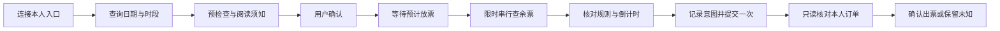

# 进阶使用与技术说明

第一次使用请先读 [首页使用指南](../README.md)。这里集中说明命令行、预约原理、运行记录和开发测试。

## 命令行

### 只读余票查询

```bash
# 查看全部健身时段；按提示粘贴本人入口，输入不回显
python3 "ticket_monitor.py"

# 只看指定时段
python3 "ticket_monitor.py" --slot "06:00-07:30"

# 每轮完成后等待 120 秒，关注两个时段
python3 "ticket_monitor.py" --watch --interval 120 --slot "06:00-07:30" --slot "19:30-21:30"

# 输出 JSON，便于后续处理
python3 "ticket_monitor.py" --json
```

`--date YYYY-MM-DD` 可限定实际使用日期；未指定时保留服务器返回的各日期。持续模式仅在首次检查、状态变化、错误及恢复时输出，按 `Ctrl+C` 停止。最小轮询间隔为 60 秒，逐票种详情查询间隔为 1 秒；网络连续失败 3 次后停止。指定时段仍会先读取全部健身票详情，再按实际使用时间筛选。

### 预约预检查与恢复

下列命令中的日期是占位符，运行前替换成实际日期。默认仅预检查，只有明确使用 `--execute` 才可能创建订单。

```bash
# 只读预检查：查看目标票种、当前须知及版本摘要
python3 "ticket_booking.py" --date "YYYY-MM-DD" --slot "06:00-07:30"

# 接受刚刚阅读的须知后，等待放票并尝试预约
python3 "ticket_booking.py" --date "YYYY-MM-DD" --slot "06:00-07:30" --execute --accept-notice "当前须知的SHA256摘要"

# 提交结果未知时，仅核对原场次，不创建订单
python3 "ticket_booking.py" --date "YYYY-MM-DD" --slot "06:00-07:30" --reconcile-only
```

| 预约参数 | 默认值 / 作用 |
| --- | --- |
| `--date` | 必填，实际使用日期 |
| `--slot` | `06:00-07:30` |
| `--execute` | 显式启用实际预约，与 `--reconcile-only` 互斥 |
| `--accept-notice` | 已阅读并接受的当前须知 SHA256 摘要 |
| `--window` | `30` 秒，可设 1–60 秒 |
| `--poll` | `0.5` 秒，可设 0.5–10 秒，保持串行 |
| `--state-dir` | 项目下的 `booking-state`，保存提交意图与结果 |
| `--diagnostics-dir` | 项目下的 `booking-diagnostics`，保存脱敏诊断 |

三个入口均支持 `--help`。预约时序、失败恢复及时间预算详见 [预约设计](../BOOKING_DESIGN.md) 和 [网络拥堵处理](../BACKEND_RESILIENCE.md)。

## 工作原理



前端只请求本机 Python 服务，由后端通过 HTTPS 与官网交互。预约后端复用连接；临时查询错误采用有限重试，并遵守服务器的 `Retry-After`。下单请求不自动重放，响应丢失时改为核对本人订单。

预计放票时间按历史观察到的规则计算：使用日的前一天、对应时段的结束时刻，时区为 `Asia/Shanghai`。规则变化或临时闭馆可能使预测失效；程序没有证明与业务服务器完成精确校时。**接口返回成功后，仍需查到对应未使用订单才报告确认出票。**

## 隐私与本地文件

站点身份保存在被 Git 忽略的 `site.local.json` 中。私人入口和登录 token 由本机进程使用，不写入配置文件、浏览器本地存储或 Cookie，不发送到其他第三方服务。正常查询和预约会向本机配置的目标站点发送必要登录及订单参数。页面提交入口后清空输入框；更换入口或重启服务后需要重新粘贴。

| 本地位置 | 内容与处理方式 |
| --- | --- |
| `site.local.json` | 目标站点来源、场馆及组织标识；仅留在本机 |
| `booking-state/` | 提交意图、核对结果，可能包含本人订单号；保留在本机，不提交仓库 |
| `booking-diagnostics/` | 接口路径、阶段、状态及耗时，不记录入口、token 或响应正文；默认不提交 |
| `*-probe-*.json`、`verification-*.json` | 本地历史检查快照，不代表实时状态；默认不提交 |

服务限制 Host、Origin 和 CSRF 请求标记，仅开放固定静态资源与业务入口，单个进程同时只允许一个操作。当前设计面向个人本机使用，不提供公网部署或多人共享模式。本机文件锁无法阻止手机或其他电脑同时下单。

**不要删除未知状态的 `booking-state` 记录来强制重试。** 先在官方预约平台核对订单；入口标识变化后，程序也无法安全推断新旧入口属于同一账号。

## 开发与测试

```bash
# Python 回归测试：含本机 HTTP、网络故障、订单恢复与凭据保护
python3 -B -m unittest discover -v

# 前端状态测试：需要 Node.js 22+，无需 npm install
node --test "test_web_ui.cjs"

# 前端语法检查
node --check "web/app.js"
```

测试不调用真实官网、不创建真实订单；Python HTTP 测试需要允许绑定本机临时端口。GitHub Actions 在 Windows、macOS 和 Linux 上运行 Python 3.9/3.13 测试，并独立运行前端检查。CI 使用 `-S` 禁用第三方包目录，验证标准库即可运行。

Python 测试共 **122 项**，其中 2 项启动文件测试仅在原生 Windows 执行，其他系统会跳过；前端状态测试共 **20 项**。覆盖站点配置、跨进程锁冲突与释放、中文路径、无时区数据库、未知库存、错误日期、凭据不泄露、限时重试、单次提交、跨重启核对、旧页面状态隔离、Host/Origin/CSRF 校验等行为。各平台实际结果以本次 GitHub Actions 记录为准。

```text
.
├── ticket_web.py             # 本机 HTTP 服务与任务状态
├── ticket_booking.py         # 预约、限时查询、提交记录与订单核对
├── ticket_monitor.py         # 独立的只读余票查询
├── ticket_config.py          # 本机站点配置与校验
├── site.example.json         # 虚构站点配置示例
├── start-ontime.cmd          # Windows 双击启动入口
├── web/                      # 无构建步骤的 HTML、CSS、JavaScript
├── test_*.py                 # Python 回归测试
├── test_web_ui.cjs            # 前端状态测试
├── ui_test_server.py          # 完全离线的界面演示
├── docs/assets/              # README 演示截图
└── .github/                  # 自动测试与协作模板
```
